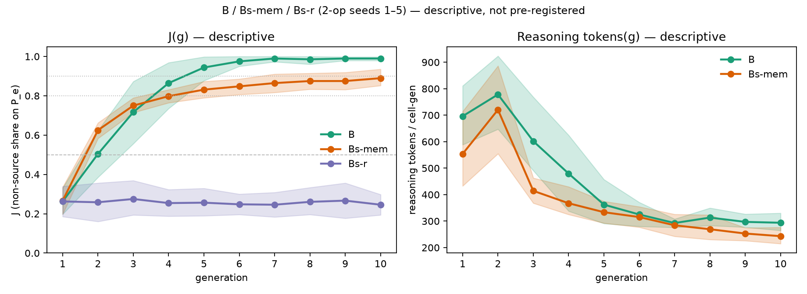
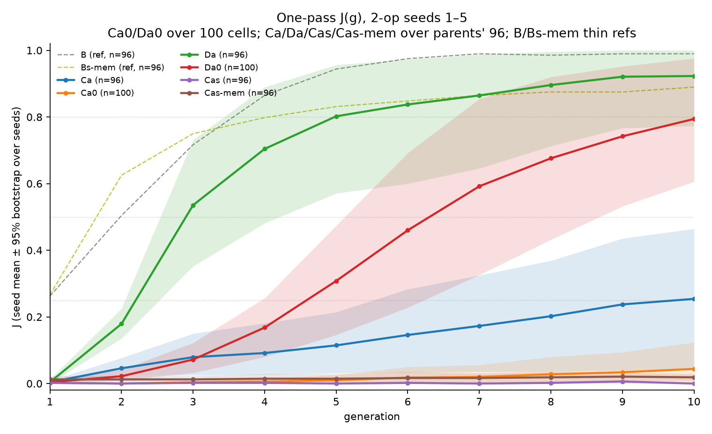

# 

# Same Weights, Three Ways to Answer

*Why Collective Reasoning Needs More Than Communication*

Oct 9, 2026 · @Artem Zvyagintsev

Asked to pick one option in a single pass, a frontier model cannot check a two-step rule (59% on pairs, near chance) and follows a false rule it is told 76% of the time. Let the same model think for a few hundred tokens and it checks almost perfectly (100%) and follows the false rule only 1% of the time. Without thinking, switching APIs changes nothing. On a grid of 100 copies, each with too little evidence to find the rule alone, the right two-step rule spreads only when agents can check what their neighbours tell them, by reasoning or with an external check. An update at the end shows that this works even when no agent is given the answer.

## The setup

The task is to check a rule against evidence. A hidden transformation maps 4-symbol strings over A–H to other strings, and the model sees a few input → output examples. The catalog has 101 candidate rules: 17 single operations (`reverse`, `rotate_left(k)`, `shift_symbols(k)`, `swap(i,j)`) and 84 compositions of two, such as `shift_symbols(1);swap(1,2)`.

Three tests, all on held-out rules:

1. **Pairs.** One true and one false candidate rule, named; does the model prefer the true one? 200 pairs, 100 single-op and 100 two-op, plus 100 three-op pairs from a separate held-out set of compositions outside the catalog. Chance is 50%.
2. **Told a lie.** A message names a false rule as the answer; does the model follow it, or recover the true rule from its examples? 84 two-op cases.
3. **Pragmatic listening.** A reference game where the right answer depends on what the speaker would have said instead (46 instances, 153 words). Scored against an ideal pragmatic listener.

One model, `gpt-6-luna` (OpenAI, public beta), asked three ways:

- **Decisions API:** one choice question, the model returns a probability for every option in one pass. Averaged over 4 option orderings.
- **Responses API, reasoning off** (`effort=none`): the model writes the option key directly.
- **Responses API, reasoning on** (`effort=medium` and `high`): the model may think before writing the key.

Responses modes were sampled 8 times per question across the 4 orderings; all modes are compared on the chosen answer, not on probabilities. Predictions and pass thresholds were [committed before any Responses number existed](https://github.com/corba777/luna_life/tree/prereg-luna-modes-lock) (tag `prereg-luna-modes-lock`; see [PROVENANCE.md](https://github.com/corba777/luna_life/blob/main/PROVENANCE.md)). The two that matter most: on two-op pairs, reasoning high beats Decisions by at least +0.15 (primary); with reasoning off, the two APIs differ by less than 0.10 (control).

## Results

&#91;embedded content: luna\_modes.json · gpt-6-luna public beta, Oct 2026 · pairs n=100 two-op, lie n=84 two-op, pragmatic 46 instances / 153 words\]

Paired cluster-bootstrap intervals against Decisions: reasoning high +0.41 \[+0.32, +0.50\] on two-op pairs, reasoning off +0.01 \[−0.06, +0.08\], and +0.35 \[+0.27, +0.44\] on pragmatic listening. On three-op pairs the gap widens: reasoning medium +0.475 \[+0.35, +0.59\] over Decisions, which falls to 52%. Medium and high sit within two points of each other wherever both ran, so depth, not effort level, is what the budget has to cover: mean reasoning tokens grow from 227 (one op) to 689 (two) to 1,349 (three).

## What it means

The model has the components the task needs; in one pass, it fails to compose them. Checking a two-op rule means applying the first operation, holding the intermediate string, applying the second and comparing. In a single pass that intermediate result has to be computed inside the network, with nowhere to write it down, and here the model does not manage it. A few hundred tokens of reasoning give it a place to write. This is a limit of the mode as observed, not a proof that one pass cannot compose: whether training can teach a one-pass model to do this step internally, in a way that transfers to compositions and environments it was not trained on, is an open question and the one I want to test next.

Three observations point the same way:

- **It is a cliff, not a slope.** One pass scores 94% on single operations, 59% on two and 52% on three: it does not degrade with depth, it drops to chance at the first composition. Reasoning stays at the ceiling at all three depths while its token count roughly doubles per added step.
- **The control holds.** Reasoning off, Responses − Decisions on two-op pairs is +0.01 \[−0.06, +0.08\]. The gain comes from thinking, not from a different API.
- **An external step works as well as an internal one.** When the environment attaches a ready-made ✓/✗ check to each candidate rule, the same one-pass model goes from 65% to 99.5% on picking the rule from the full catalog. On pragmatic listening, an explicit step built from the same one-pass model also works: asking it, for each candidate item, what word it would have said, and picking the item that best explains the word heard, lifts it from 61% to 93% \[+0.23, +0.40\] with no reasoning at all, matching reasoning medium (93%; `pragmatic_argmax_L2` = 0.935 in `luna_modes.json`). Inverting a neural speaker to get a pragmatic listener is an established method ([Andreas & Klein, 2016](https://arxiv.org/abs/1604.00562); [Fried et al., 2018](https://arxiv.org/abs/1711.04987)); what is new here is that it matches reasoning on the same weights. Since the reference listener is itself defined by inverting a speaker, this shows the model's speaker carries what its one-pass listener ignores, not that the model becomes pragmatic in general. Someone has to do the intermediate step; it does not matter much who.

This is the familiar compositionality gap of language models: each step known, the composition not done without an explicit chain. The new part is seeing it inside one set of weights, with the reasoning budget as the only thing changed, and a dose curve that saturates early: medium (mean \~690 reasoning tokens on two-op pairs, \~460 across all pairs) is already at the ceiling.

## Caveats

- **One model, one task family.** String transformations over a 101-rule catalog. Other domains may need more or fewer steps. The three-op rules come from a separate held-out set outside the catalog, with two extra options per question, so the 1 → 2 → 3 comparison is not a pure change of depth.
- **Public beta.** `gpt-6-luna` and the Decisions API may change before release. How Decisions mode is built internally is not documented, so I make no claim about it beyond what it outputs.
- **Different estimators.** Decisions returns probabilities; Responses modes are estimated from 8 samples, with ties scored as half. That is why every comparison is on the chosen answer.
- **Small held-out sets.** Intervals are cluster bootstraps over the 26 held-out two-op functions (pairs) or the 46 instances (pragmatic listening).
- **Validity.** 0 invalid answers with reasoning off or medium; 1 truncated answer out of 1,600 at high, where reasoning hit the 8,192-token cap.

## Why this matters for multi-agent work

I study whether a population of decision-model agents on a 10×10 grid can spread a correct rule by messaging each other. An agent that follows whatever its neighbours say spreads errors as easily as truths; spreading the truth needs agents that check claims against their own evidence.

These results say one-pass decision models, small or frontier, do not check two-step claims, while the same weights with a little reasoning do. That splits the next steps into two routes:

- **Verify from outside:** the environment attaches checks to messages ([our engine-check stand](https://github.com/corba777/luna_life/tree/main/life_verify)).
- **Verify from inside:** agents that reason, or decision models trained to make the intermediate step within one pass.

I put both on the same grid, with each agent given too little evidence to find the rule alone.

## On the grid

> **Correction, Oct 13, 2026.** The no-channel control in this section removed two things, not one:
> the neighbours' messages and each agent's memory of its own previous rule. With that memory
> restored and still no messages, a single reasoning agent reaches 0.89 on two-step rules (end of
> run), against 0.99 with messages. The claims below that two-step rules are solved "only
> collectively" and that messages make them "possible" do not hold for reasoning agents. The
> single-agent results above are unaffected. See the update at the end.

Single rules are solved by each reasoning agent alone. Two-step rules are solved only collectively, and only when incoming claims are checked: by the agent's own reasoning or by the environment.

The same `gpt-6-luna`, now as 100 cells on a 10×10 torus. Four source cells hold the true rule. (For reasoning cells they turn out not to matter; see the update.) Every other cell sees one example that fits more than one rule, so it cannot identify the rule alone. Each generation a cell picks a rule, is told whether it was right and, with the channel on, publishes its rule to its neighbours. J is the share of non-source cells holding the true rule, averaged over 10 generations; 5 seeds per depth. "Solved" below means most non-source cells come to hold the true rule and keep holding it, not that some cells find it.

| cells | channel | check on incoming rules | J, one-op | J, two-op |
| --- | --- | --- | --- | --- |
| reasoning medium | on | own reasoning | 0.99 | 0.82 |
| reasoning medium | off | — | 0.93 | 0.25 |
| Decisions (argmax) | on | none | 0.53 | 0.14 |
| Decisions (argmax) | off | — | 0.19 | 0.00 |
| Decisions (argmax) | on | engine ✓/✗ | 0.88 | 0.67 |

&#91;image: J by generation: reasoning and one-pass cells, with and without the channel, and one-pass cells with engine checks; one-op and two-op panels\]

Share of non-source cells holding the true rule, by generation; bands are 95% bootstrap intervals over 5 seeds. "Silent" = no channel; "one-pass" = Decisions API; "+ check" = engine ✓/✗ on incoming rules. The dashed black line is the topological reachability bound: how fast the rule could spread on this grid if every cell adopted it on first contact.

- **Messages make two-op rules possible, not just faster.** With the channel, reasoning cells lock on the true rule in all 5 two-op seeds by generation 2–4; without it they stay at 0.25 (+0.57 \[+0.55, +0.61\]). On one-op rules each reasoning cell finds the rule alone, so the channel adds little.
- **Collective correction has two stages.** A reasoning cell checks each incoming rule against its own example and does not adopt one that contradicts it (98% of the time, in the three seeds traced). Among the rules that fit, it switches to the true one when told its own answer was wrong and the true rule is in its inbox (87%). One-pass cells keep the second stage and lack the first: in the three seeds I traced, all 70 cells that switched to a neighbour's rule had just been told they were wrong, but they took rules contradicting their own example as readily as rules that fit it. That stage alone still lets some truth through: without the channel one-pass cells never reach a two-op rule (J 0.00); with it they reach 0.14 (+0.13 \[+0.03, +0.25\]). I had predicted no difference. On one-op rules, which one-pass cells can check, the channel matters more: 0.53 against 0.19 (+0.34 \[+0.20, +0.47\]).
- **Identical agents agree without talking, sometimes on the wrong answer.** In one two-op task, the first operation of the true rule alone fits 97% of the cells' examples. Without a channel, 78% of reasoning cells picked that simpler rule independently in the first generation (31% would pick a single-op rule if cells chose evenly among the rules that fit their example) and held it for all ten, although they were told their answer was wrong in 90% of generations: with nothing better in sight, "wrong" alone did not move them. Knowing an answer is wrong is not the same as having a better one, even for a reasoning model. One-pass cells did the same (98%). With messages, reasoning cells left it within a generation. A shared prior makes copies of one model agree; agreement alone is no evidence that they communicated. This is one task out of five, so it is an observation, not a rate.
- **Delegated verification works for one-pass agents.** With an engine ✓/✗ attached to each incoming rule, one-pass cells reach 0.67 on two-op rules (0.92 by generation 10), against 0.14 without (+0.53 \[+0.31, +0.70\]). It helps on one-op rules too, 0.88 against 0.53 (+0.35 \[+0.16, +0.56\]): picking from 101 rules with one example is harder than choosing between two. On two-op rules it is slower than reasoning cells, and not yet level with them: by generation 10, 0.92 against 0.99.
- **An engine check cannot break that kind of agreement.** The check tests whether a rule fits the examples, and the simpler false rule does: it solves local consistency, not identifiability. In that task, one-pass cells with engine checks locked on the false rule for 7 of 10 generations before recovering. Only the combination of "you were wrong" and the true rule arriving from a neighbour breaks it.

Caveats specific to the grid: one model, 5 seeds per depth, one 10-generation epoch, and a lock threshold (modal share ≥ 0.5) chosen in advance; at 0.6 the false-agreement result above survives and two borderline cases disappear.

The pattern is the one from the single-agent tests, scaled up: in these experiments, collective inference worked only when incoming claims were checked, by the agents or by the environment, and a channel without a check passed errors along with truths. Whether a one-pass model can be trained to make that check itself is the next question.

## Update, Oct 11, 2026: does the grid need a teacher?

The grid runs above seed four "source" cells with the true rule. I reran the two-op tasks with one
source and with none: same model, same five tasks, same private examples, with predictions committed
before the runs.

| reasoning cells, two-op | J at generation 10 | J averaged over 10 generations |
|---|---|---|
| 4 sources (as above) | 0.99 | 0.82 |
| 1 source | 0.98 | 0.80 |
| 0 sources | 0.99 | 0.82 |
| 0 sources, no messages | 0.25 | 0.25 |

**No teacher needed.** With no seeded source, all five populations converge on the true rule (98–100%
of cells by generation 10). In the first generation, 23–39% of cells find the two-step rule on their
own, as they do without messages. The rest are told they are wrong and check the candidates their
neighbours send. Even with one source, 70–88% of the cells holding the rule at the end trace it only
to such solo finds, not to the source.

**A minority overturns a majority.** In the task where the simpler first operation fits almost every
example, 75% of cells start on the false rule and 23% on the true one. Without messages, the false
majority holds for all ten generations. With messages and no source, the true rule is the majority by
generation 3 and is held by 98% of cells at generation 10. I had predicted the opposite: that without a
seeded source the population would stay locked on the false rule.

**Checks narrow the field; votes break ties.** A cell that has been told it is wrong, and has only one
incoming rule that survives its own check, usually switches on a single neighbour's message (77% per
generation; 87% with three or more neighbours sending it). When two rules survive the check, the
number of neighbours decides (25% with one, 75% with three or more). One-pass Decisions cells follow
the crowd either way (4% with one, 27% with three or more): they have no check to narrow the field.

One-pass decision cells behave differently. They almost never find the rule alone, so they depend on
the source. With an external check on incoming claims, a single source's rule travels the whole grid
(92% of cells at generation 10, 80% tracing it back to the source). Without the check, the wave dies
within a few steps (10%).

> *Oct 13: with engine checks, one-pass populations also reach the rule without a source (0.79 at
> generation 10, all five tasks); see below.*

**What this changes.** The conclusion above stands: collective inference needed a check on incoming
claims. But "a seeded truth spreading through the grid" is the wrong picture for reasoning cells. In
these runs the true rule was present from the first generation, so what the grid did was select among
hypotheses some agents already held. In follow-up runs where each agent's evidence was more
ambiguous, the true rule sometimes won although no agent held it at the start; I am testing what
drives that.

Caveats: one model, five tasks, one 10×10 grid on which no cell is more than five steps from any
other. The share of solo finds depends on how much evidence each cell gets. With more ambiguous
evidence the outcome varies: at the highest ambiguity I tried, three of five populations ended on a
false rule. Two of my predictions for these runs failed: I expected most switches on the wavefront
to involve a single neighbour (19% did, because solo finds are everywhere), and I expected the
zero-source population to stay on the false rule in the hard task (it did not).

*Edited Oct 12: two sentences narrowed after follow-up runs.*
*Edited Oct 13: one-pass zero-source line.*

## Update, Oct 13, 2026: it was the memory

### One line in the prompt

Each generation, a cell sees one line about its previous step. With the channel on, a cell that
published its rule sees it:

```
Previous step: answer=BCBH correct=false published signal=0 say='shift_symbols(1);swap(2,3)'.
```

With the channel off, the same cell saw this:

```
Previous step: answer=BCBH correct=false silence.
```

It knew it had been wrong, but not which rule had been wrong. The memory code stored the rule
only as the content of the message, so turning messages off also erased the agent's record of its
own hypothesis. Every "no channel" control in this article changed two things at once.

### The test

I added the rule back to the silent agents' memory line and changed nothing else:

```
Previous step: answer=BCBH correct=false silence held_rule='shift_symbols(1);swap(2,3)'.
```

A line-by-line diff of the rendered prompts confirmed this was the only difference, and the
request hashes in the API cache confirmed the model received it. Predictions were committed
before the runs. Same five two-step tasks, same examples, ten generations.

| reasoning cells, two-step | J at generation 10 | J averaged over 10 generations |
|---|---|---|
| messages (as above) | 0.99 | 0.82 |
| no messages, own previous rule shown | **0.89** | **0.76** |
| no messages, own previous rule hidden (as above) | 0.25 | 0.26 |

The agent with its own rule in memory beat the agent without it in all five tasks. I had predicted
that messages would still account for at least 0.20 of the gap; they account for 0.10.

### Why memory matters this much

Memory works in two ways.

- **Finding.** Told it was wrong, an agent that sees its refuted rule tries something else, and
  finds the true rule three times as often (0.31 vs 0.11 per generation). An agent that does not
  see it re-derives the same rule from the same example and repeats the mistake: it kept the same
  rule after "wrong" 94% of the time, against 8% with memory. The earlier observation that
  "'wrong' alone did not move them" was this. The agents could not tell which answer had been
  wrong.
- **Keeping.** An agent that found the true rule and was told it was right kept it 99.7% of the
  time with memory, and 69% without. Without memory, a correct answer survives about two
  generations.

These two rates explain the flat line of the memoryless population. If a cell finds the rule with
probability h and loses it with probability 1 − r, the steady share is h / (h + 1 − r) =
0.11 / (0.11 + 0.31) ≈ 0.26, against the observed 0.25. Those agents were not failing to solve the
task. They kept finding the rule and losing it again.

### What messages add

The curves by generation give a different picture from the one above.



- **Not a faster start.** Agents with memory and no messages are ahead early (0.62 vs 0.50 at
  generation 2). Incoming messages full of the common wrong rule seem to slow independent search,
  though this is descriptive.
- **The tail.** Alone, 85–90% of cells get there and stop. 0.9 was reached in two of five tasks.
  With messages, all five tasks pass 0.9 by generation 3–6. The cells that never find the rule
  alone are not stuck on a lucky wrong answer. They cycle: two thirds of their generations
  return to a rule already refuted, often alternating between two (median cycle of 4 returns). A
  one-step memory cannot rule out what it no longer remembers. With messages, the true rule
  arrives from a neighbour right after a "wrong": 25 of 27 late switches happened that way.
- **Not cheaper.** With messages, reasoning cells spend more reasoning tokens per generation, not
  fewer.

### At higher ambiguity

In the harder tasks, where the first operation alone fits almost every example, the result
repeats. With its own rule in memory and no messages, an agent proposes the true rule on its own
at a rate of 0.039 per generation; with the rule hidden, never. Shown as "published" or
not, the rate is the same (0.041 vs 0.039): the rule in memory matters, not publication. These
populations also lock on the wrong majority rule without any channel (30–50% of generations), so
false agreement there is a shared prior, not a social effect.

### One-pass agents: where the collective does real work

One-pass Decisions agents gain nothing from memory on two-step rules (0.02 at generation 10 with
their rule shown, 0.00 without). Alone, a one-pass agent hits the true rule by luck in well under 1%
of generations. I reran the one-pass populations with no seeded source, with and without engine
checks on incoming rules. Predictions were committed before the runs.

| one-pass cells, two-step | J at generation 10 |
|---|---|
| alone (no channel) | 0.00 |
| alone, own previous rule shown | 0.02 |
| channel, no check, no source | 0.04 |
| channel, no check, 4 sources | 0.25 |
| channel + engine check, no source | **0.79** |
| channel + engine check, 4 sources | 0.92 |



Without a source and with checks, one-pass populations reached the true rule in all five tasks
(0.48 to 1.00 at generation 10), and the curves were still rising. I had predicted that they would
stay at least 0.20 below the seeded runs. They came within 0.13. The update of Oct 11 said one-pass
cells "depend on the source". With engine checks, they don't.

The mechanism is simple and fully collective. A lucky find appears somewhere. Its neighbours
receive it with a ✓, and one checked message converts a neighbour 40% of the time, against 3%
without the check. Retention is high either way (about 0.97), so the check works on adoption, not
on memory. No member of this population can identify the rule. The population turns a fraction
of a percent of individual luck into 79% of cells holding the rule. This is the first effect in
these experiments that no single agent, with or without memory, reproduces. It depends on an
external check: the environment does the verifying, so it is closer to a search with verified
propagation than to agents reasoning together. Whether an agent can take the checker's place is
the next test.

Without the check, the outcome is a lottery. A projection from the measured adoption and retention
rates (a model, not a run) puts seeded populations without checks anywhere between 0 and 0.94 by
generation 30, depending on the task. In one task, a cell adopted a correct rule from a neighbour
0.3% of the time. Without a check, a one-pass agent adopts what looks plausible to it, not what is
true.

### A note on cost

At OpenAI's list prices, the one-pass populations here cost more per task than the reasoning
populations: about $1.0–1.1 against $0.33–0.44. A one-pass answer is averaged over four option
orderings, and that matters: with a single ordering, 71% of a lone one-pass agent's rule choices
change. That is an API price, not a compute cost. A one-pass decision reads the prompt and scores
the options without generating text. On local hardware, four orderings mostly share the same
prefix, while a reasoning agent generates hundreds of tokens per answer. On one's own GPU, a slow
population of cheap verified agents may well be the economical option. I have not measured that
yet.

### What still holds

The single-agent results at the top of this article stand: they involve no memory, no generations
and no channel. On the grid, the checking behaviour stands. Reasoning agents reject incoming rules
that contradict their own example, and engine checks let one-pass agents reach 0.67. The numbers
in the tables above are correct. What changes is what they mean.

### What I got wrong, and how I found it

The control was mine, and so was the mistake: I checked that the intended input changed, not
that nothing else did. A line-by-line diff of two prompts would have shown it on the first day.
Every comparison I report now starts with that diff, and the gate fails on any difference not
listed in advance.

Three of my post-hoc readings during this work were also overturned by the registered test that
followed:
- a split inside the message runs suggested discovery did not depend on memory;
- I expected the stuck agents to be lucky with a wrong rule;
- I called false agreement the one genuinely collective effect.

One registered prediction failed as well: I expected one-pass agents with checks to need a seeded
source.

A neighbour-based heuristic for "who published" produced a threefold effect that disappeared when
I recovered the exact status from the cache keys.

### Where this leaves the question

In this task, with this model, the answer depends on the agents.

- **Agents that reason and remember their own attempts** solve the task alone. For them the
  collective is a delivery system: messages bring the last 10–15% of agents along.
- **Agents that cannot solve it alone** (one pass, no reasoning) need the collective and a check.
  Together they reach a rule none of them can find, without any teacher. Without the check they
  depend on luck and on how plausible the right answer looks.

Across all of this, an explicit step does the work: reasoning, remembering one's refuted attempts,
or a check on incoming claims. Communication matters when it carries the output of such a step to
agents that cannot take it themselves. This fits what others have found when the memory of earlier attempts, including
failed ones, is kept explicitly: GitSwarm's shared repository keeps failed work, and the
designer in SPADE relies on an accumulated memory of environments.

It also means this task cannot show emergence. Each cell's own example, plus "right/wrong"
feedback and ten generations of memory, is enough to identify the rule. A collective is necessary
only when no single agent's information is enough: the evidence is split across agents, or there
is no individual feedback to learn from. That is the next experiment, with `gpt-6-luna` as the
reference and our own decision models alongside it.

Caveats: one model, five tasks per ambiguity level, a closed catalog of 101 rules, one 10×10 grid.
The memory line holds one step. A fuller history of refuted rules may close the remaining gap
without messages, which is a test I have not run.

*Update added Oct 13, 2026. Edited Oct 13: one-pass zero-source results, cost note, split
conclusion. Prompts, gate diffs, predictions and analyses: `TASK_LIFE_OWN_MEMORY.md`,
`prompts/own_memory_gate_diffs.md`, `runs/life_own_memory/`; one-pass arms:
`runs/life_onepass_no_source/`.*
