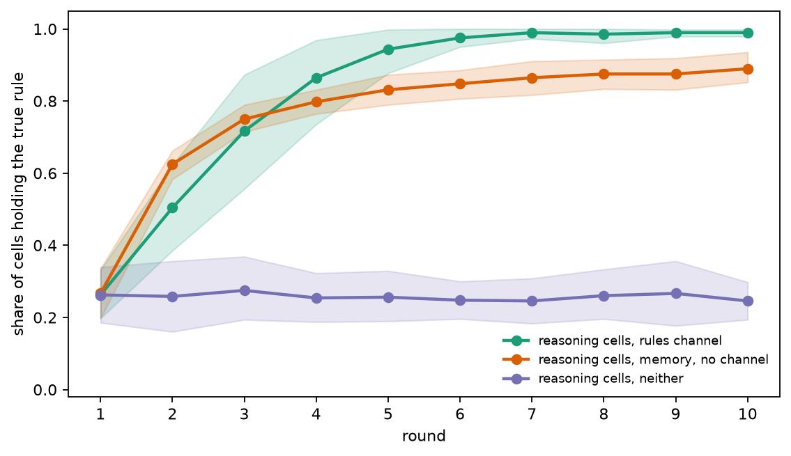
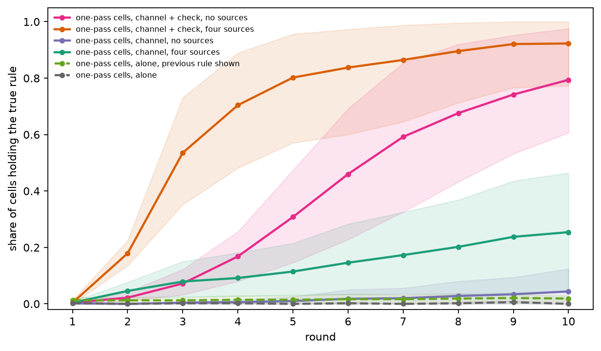
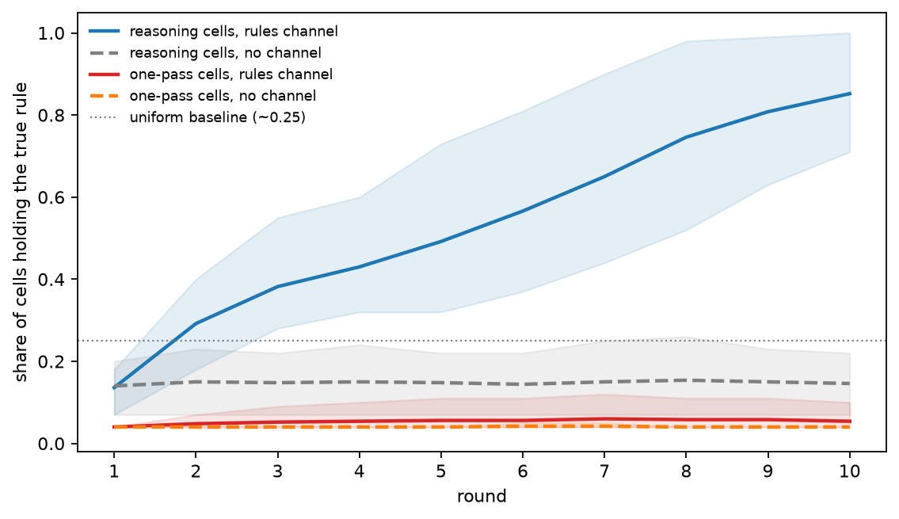
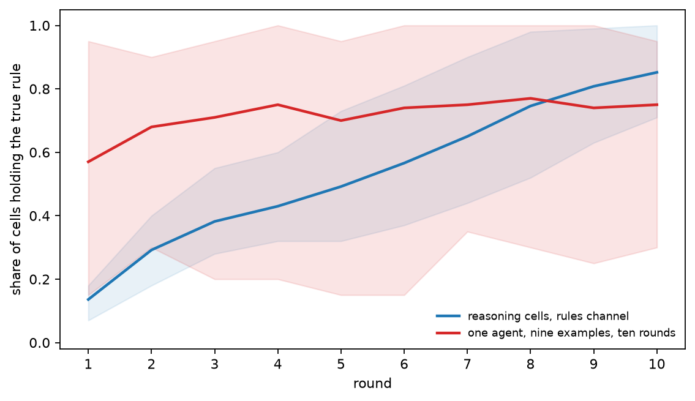
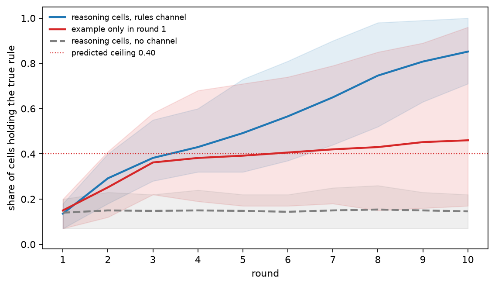

# What None of Them Knew

*When does a population of language-model agents know something none of its members can?*

---

Imagine a puzzle in which every participant holds one piece, and no piece is enough on its own.

A hundred language-model agents sit on a ten-by-ten grid that wraps around at the edges. Each holds
a single example of a hidden rule: four letters in, four letters out. No single example is enough
to name the rule; each one fits at least three rules in the catalog, and in many cells a simpler
wrong rule fits too. The agents cannot see each other's examples. Once per round each may post the
name of one rule to its eight neighbours, nothing else. Nobody is ever told whether they are right.

In the first round, 14% of the agents hold the true rule, fewer than a blind pick among the rules
that fit each example would give. By the
tenth round, 85% do. Without the channel, the same agents stay at 15% for all ten rounds.

That is the result this piece builds to. Getting there took a mistake, several failed predictions,
and a better question than the one I started with.

## The question

The project is called Constitutional Life. Each cell of the grid is a language model (here
`gpt-6-luna`, through the OpenAI API) that reads the same short constitution, its private
examples, a one-line memory of its previous step and up to eight messages from neighbours. Each
round it names the rule it believes in, answers a query with it, and may publish a short message.
The rules come from a fixed catalog of 101 string transformations: shifts, swaps, reversals and
two-step compositions of them.

The question was simple: when does local talk between agents turn into something the population
knows and the individuals do not?

## The first answer looked like emergence

In the first version of the world, every cell had enough examples to identify a two-step rule on
its own if it reasoned carefully, received "right" or "wrong" after each round, and four seeded
cells held the true rule from the start. Reasoning cells that could message each other reached
0.99 by round ten. The same cells with the channel switched off reached 0.25.

That looked like the answer: talk turned a quarter into nearly everyone. I wrote it up that way.

## One line in the prompt

The control was flawed. Switching the channel off did not only silence the agents; it also wiped
each agent's memory of its own last hypothesis. A silent agent knew it had been wrong, but not
which rule had been wrong.

The evidence is one line. Each round, a cell sees a line about its previous step. With the channel
on, a cell that had published its rule saw:

```
Previous step: answer=BCBH correct=false published signal=0 say='shift_symbols(1);swap(2,3)'.
```

With the channel off, the same cell saw:

```
Previous step: answer=BCBH correct=false silence.
```

The memory code stored the agent's rule only as the content of its message, so turning messages
off erased it. Every "no channel" control I had run changed two things at once.

A line-by-line diff of two rendered prompts would have shown this on the first day. I had checked
that the thing I meant to change did change, not that nothing else did.

With the rule restored to the silent agents' memory and nothing else changed (confirmed by
diffing the requests actually sent), a single reasoning agent with no messages reached **0.89**.
The predictions were registered before the runs; I had predicted that messages would still
account for at least 0.20 of the gap. They accounted for 0.10.



*With memory restored, silent reasoning cells climb near the messaging population; without memory they stay near chance.*

Memory mattered in two ways. Told it was wrong, an agent that could see its refuted rule tried
something else and found the true rule three times as often (31% vs 11% per round). Without that
line it re-derived the same rule from the same examples and kept it 94% of the time. And once an
agent had the rule, memory let it keep it: 99.7% of the time, against 69% without. The
memoryless population was not failing to find the rule. It kept finding it and losing it again;
a find rate of 0.11 and a loss rate of 0.31 predict a steady share of 0.26, against the observed 0.25.

Messages still did something, just not the thing I had claimed. Alone, 85–90% of agents found the
rule and the rest cycled among refuted rules; a one-step memory cannot rule out what it no longer
remembers. With messages, the true rule arrived from a neighbour right after a "wrong", and every
task passed 0.9. The collective was a delivery system for the last tenth.

## Agents that cannot think alone

Reasoning agents with memory solve that world alone. The more interesting case is agents that
cannot.

`gpt-6-luna` can also answer in one pass, through a decisions endpoint that scores the catalog
options without generating any reasoning. A one-pass agent alone essentially never names a
two-step rule (0.00 by round ten). On the grid, one thing made the difference: whether incoming
rules were checked. Without a check and without a teacher, populations stayed at 0.04; with the
environment checking each incoming rule against the receiving cell's example, they reached 0.79.
The full progression:

| one-pass agents, two-step rules | round 10 |
|---|---|
| alone | 0.00 |
| alone, own previous rule shown | 0.02 |
| channel, no seeded sources | 0.04 |
| channel, four seeded sources | 0.25 |
| channel + engine check of incoming rules, no sources | **0.79** |
| channel + engine check, four sources | 0.92 |



*One-pass populations climb only when the environment checks incoming rules against each cell's example.*

The engine check is the environment rejecting any incoming rule that contradicts the receiving
cell's example. With it, a population with no teacher turns a fraction of a percent of lucky
individual finds into 79% of cells holding the rule, and is still rising at round ten. One checked
message converts a neighbour 40% of the time; one unchecked message, 3%. No member of that
population can identify the rule. But the environment is doing the verifying.

A third kind of agent, the reasoning model with reasoning switched off, reached 0.47 on the grid,
against my prediction that it would match the one-pass agents. It does not check incoming rules
either; it simply changes its mind more easily, and with four cells that publish the true rule
every round and never change theirs, that is enough. Without those cells it reached 0.01. At
temperature 0 it was just as mobile and did a little better (0.62), so the mobility is not
sampling noise; and making the one-pass agent random, by sampling its choice from its own
probabilities, did not reproduce the effect: it dropped the rule almost at once.

Across this first world, the work was done by an explicit step — reasoning, remembering one's
refuted attempts, or a check on incoming claims. Communication mattered when it carried the output
of such a step to agents that could not take it themselves.

Which meant I had not built a world that needed a crowd. I had built a world that needed memory,
or reasoning, or a checker. The original question had not been tested at all.

## A world that needs a crowd

So I built one. The requirements, fixed in advance:

- **No individual can solve it.** Each cell gets one example, and every example fits at least
  three catalog rules. A uniform pick among the rules that fit each cell's example would be right
  25% of the time on average across the five worlds.
- **The neighbourhood can.** Over any cell plus its eight neighbours, the only rule consistent with
  all nine examples is the true one. A script checked this for every cell of every world before
  any model call.
- **A tempting wrong answer.** In at least 40% of cells a one-step rule fits the example.
- **Nothing to lean on.** No seeded sources, no "right" or "wrong", no external check.
- **Rules only.** A message is delivered only if it parses to a catalog rule. Examples cannot be
  passed around, so cells cannot simply pool their data.

Each cell's memory says which rule it held last round and whether it published it, and nothing
about correctness. Five worlds, ten rounds, the same reasoning model as before.

The predictions, registered before any run: without the channel, populations do not exceed chance by
more than 0.15 (otherwise the world is solvable alone and nothing else is interpreted); with the channel,
reasoning populations beat the silent ones by at least 0.30 in four of five worlds; one-pass
populations gain less than 0.15 from the channel; and a single agent given all nine examples of a
neighbourhood at once gets at least 0.80.

## The result



*In the distributed world, only reasoning cells with a rules channel climb; silence and one-pass arms stay flat.*

| | channel | round 1 | round 10 |
|---|---|---|---|
| reasoning cells | no | 0.14 | 0.15 |
| reasoning cells | rules only | 0.14 | **0.85** |
| one-pass cells | no | 0.04 | 0.04 |
| one-pass cells | rules only | 0.04 | 0.05 |

Without the channel, reasoning cells sit at 0.15 — below that uniform baseline, because the tempting one-step
rule pulls them away from the truth. With the channel they climb steadily: 1.00, 0.80, 0.75, 0.71
and 1.00 in the five worlds, and they are still rising at round ten. The gap is at least 0.60 in
every world. One-pass cells do not move with or without the channel.

This is the first effect in these experiments that needs neither a teacher, nor feedback, nor an
external check, and that no member could produce alone.

## How it works

For every switch to the true rule, I asked whether the cell had received it from a neighbour.
Between 76% and 92% of switches, depending on the world, had. Not one switch is explained by the
rule merely being the most common in the inbox. The true rule fits every cell's example by
construction, so these numbers show that it spreads by being passed on, not by majority; on their
own they do not show how strictly cells reject the wrong rules they receive.

So I counted every rule a cell received, true or false, and whether it took it. When a
neighbour's rule was the most common one in the inbox and fit the cell's own example, reasoning
cells took it 65% of the time. When it was just as common but contradicted their example, they
took it 2% of the time. One-pass cells barely made the distinction: 17% against 8%. This is a
count after the fact, not a registered test, and the two groups of rules can differ in other ways
(length, how often they circulate), so it is not a matched comparison. But the pattern is sharp: reasoning cells use their
own example to filter what they hear, and popularity does not get a contradicting rule past
them.

Cells whose example rules out the tempting one-step rule are the key. In one world, a quarter of
the cells had such an example; 15 of those 25 held the true rule in the first round, before any
message, and 21 by the second. Their neighbours, whose examples fit both the tempting rule and the
true one, then received the true rule and took it. Nobody intersects nine examples. The
intersection happens across cells.

The one prediction about the world itself failed. A single agent given all nine examples of a
neighbourhood in one prompt named the true rule only 56% of the time, not 80%. Since the script
had proved that the information was there, this measures something else: one agent asked once
does not reliably assemble nine examples into one answer.

Was the population's advantage just that it got ten rounds? I gave the nine-example agent ten
rounds and memory of its own rule, and registered the prediction that it would still end at least
0.10 below the population. It ended at 0.75 against 0.85. The prediction held, by 0.002, and almost
all of the gap comes from one world:

| world | population | one agent, nine examples, ten rounds |
|---|---|---|
| 1 | 1.00 | **0.30** |
| 2 | 0.80 | 0.80 |
| 3 | 0.75 | 0.80 |
| 4 | 0.71 | 0.90 |
| 5 | 1.00 | 0.95 |



*Ten rounds of one agent with a neighbourhood's evidence still lag the population, mostly in one world.*

In four worlds, one agent with all the evidence and enough time does as well as the population.
In the first, it does not. There, 14 of the 20 nine-example agents settled on the tempting
one-step rule, which fits seven of their nine examples, and never left it. With no feedback,
"explains almost everything" is a stable resting place. The population does not have that option:
most of the cells whose single example contradicts the tempting rule do not take it up, and
pass on the alternative instead. A constraint that no one sees whole is enforced piece by piece.

Think of an investigator with all nine pieces of evidence on the desk. Seven point the same way;
the two that do not fit are easy to explain away. Now think of a juror who has seen only one of
those two. The juror does not weigh it against the other eight; the juror simply will not sign. The
investigator settles. The jury does not.

That is a description of one world, not yet a law. There is also an honest imbalance in the
comparison: over ten rounds, rules that survived checking in one neighbourhood travel to the
next, so a population cell is indirectly informed by more than nine examples. The nine-example
agent sees the same nine every time.

Why does a population of refusers not deadlock? Because the refusals are not symmetric. Every
wrong rule contradicts at least one example in every neighbourhood, so every neighbourhood has a
cell whose evidence rules it out. The true rule fits every example by construction, so no cell's
evidence rules it out. That gives the true rule a structural advantage, not a guarantee: it still
has to be proposed, passed on and chosen over other rules that happen to fit, and the agents do
that imperfectly.

Counting is not the same as causing, so I removed the evidence. In a fresh run of the same five
worlds, each cell saw its example in the first round and never again; it kept its memory and its
inbox. I predicted that this would wipe out most of the effect. It did less than that. The filter
vanished: a contradicting rule that was the most common in the inbox was now taken 47% of the time
instead of 2%. The population fell from 0.85 to 0.46, still far above the 0.15 of the silent cells.



*Removing each cell's example after round one stalls the climb after early spread; the silent population stays low.*

The curves show where the example matters. For three rounds the two populations rise together; the
first round, played with the example, and plain spreading carry them to about 0.4. Then they part.
With the example, the population keeps climbing. Without it, it stalls. The prediction failed in
three of five worlds, and in one world removing the example made no difference at all (0.96
against 1.00). A cell's own evidence is not what gets the true rule started. It is what lets it
keep winning after the easy spread is over. Removing the example takes away more than the check —
the cell also loses it for its own choices — so this shows that the evidence is needed, not that
the check alone is.

## What this does and does not show

It shows that, for this model and this kind of task, a population of reasoning agents that pass
only rule names can identify a rule that none of them can identify alone, without feedback or
outside verification, and that the true rule spreads by being passed between cells rather than
by majority copying. Reasoning cells filter incoming rules against their own evidence; taking that
evidence away after the first round breaks the filtering and cuts the collective gain by about
half, though it does not isolate the check from other uses of that evidence. One-pass
agents, which do not check, get nothing from the same channel.

It does not show that a population beats any well-informed individual: in four of five worlds a
single agent with all of a neighbourhood's evidence and ten tries did as well. It is one model,
five worlds, a closed catalog of 101 rules and one grid size, and the populations were still
improving when the runs stopped.

## What failed, and how I checked

Several registered predictions failed along the way: that silent agents would still lag by at
least 0.20 once memory was restored; that one-pass agents with checks would need a seeded source;
that the reasoning-off agent would behave like the one-pass agent, then that its advantage came
from checking, then from sampling noise; that one agent with nine examples would reach 0.80; and
that removing each cell's example would remove most of the collective effect.
Four of my unregistered readings were overturned by the test that followed them. They stay in the
record.

The checks that now run on every experiment came from those mistakes. The gate compares the raw
bytes of the request the runner actually sends, not a reconstruction of it. A masked copy of the
second-round request is checked against the reviewed template before any third-round request
goes out. Each arm gets its own empty cache, and a run that answers from cache when it should be
asking the model stops itself. That last rule exists because one control run, labelled as a new
condition, silently replayed an older experiment from a shared cache and cost nothing. The
numbers were real but belonged to a different arm.

## Next

All of this ran on a closed model. The next step is open ones: a 4B model trained by self-play
([SPADE](https://arxiv.org/abs/2608.19197)) already verifies two-step rules with reasoning on our single-agent tests (0.94), and the
distributed world will be rerun with local cells. Whether a cheap one-pass model can be taught the
check — the one thing the reasoning cells do that the one-pass cells do not — is the other open
question. A first attempt stopped at the gate: the open 4B teacher checked correctly in 86% of
cases where we needed 90%, largely because its long reasoning ran out of room (92% on the answers
it finished).

## Related work

This sits next to two recent lines of work. [Sakana's MASS](https://arxiv.org/abs/2610.12176) uses a multi-agent system to generate
behaviour and trains a single model on it; [GitSwarm](https://arxiv.org/abs/2610.04862) keeps agents' failed attempts in a shared
repository so others do not repeat them. In both, the collective produces or stores something.
Here the central mechanism is different: each agent tests incoming claims against its private
evidence, and locally supported hypotheses spread.

## What none of them knew

None of the agents in the last world knew the answer, and none was told when it was wrong. Each
did two small things: it passed on what it believed, and it refused a claim that contradicted its
own piece of evidence. That was enough for the population to come to hold what none of them knew.

---

*Predictions, gate diffs and run logs for every number above are in the [project repository](https://github.com/corba777/luna_life):
[`TASK_LIFE_OWN_MEMORY.md`](https://github.com/corba777/luna_life/blob/main/prereg/TASK_LIFE_OWN_MEMORY.md),
[`TASK_LIFE_ONEPASS_NO_SOURCE.md`](https://github.com/corba777/luna_life/blob/main/prereg/TASK_LIFE_ONEPASS_NO_SOURCE.md),
[`TASK_LIFE_LUNA_NONE.md`](https://github.com/corba777/luna_life/blob/main/prereg/TASK_LIFE_LUNA_NONE.md),
[`TASK_LIFE_DISTRIBUTED.md`](https://github.com/corba777/luna_life/blob/main/prereg/TASK_LIFE_DISTRIBUTED.md),
[`TASK_LIFE_DRO_ITER.md`](https://github.com/corba777/luna_life/blob/main/prereg/TASK_LIFE_DRO_ITER.md)
and [`TASK_LIFE_DR_NOEX.md`](https://github.com/corba777/luna_life/blob/main/prereg/TASK_LIFE_DR_NOEX.md). The earlier
write-up, with its corrections, remains [online](https://corba777.github.io/luna_life/).*