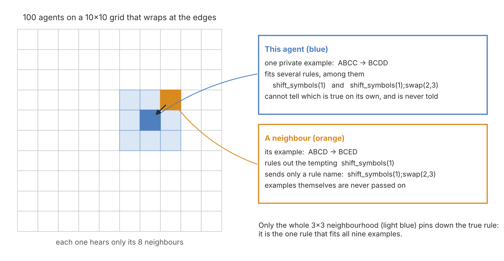

# What None of Them Knew

*When does a population of language-model agents know something none of its members can?*

---

Imagine a puzzle in which every participant holds one piece, and no piece is enough on its own.

A hundred language-model agents sit on a ten-by-ten grid that wraps around at the edges. Each holds
a single example of a hidden rule: four letters in, four letters out. No single example is enough
to name the rule; each one fits at least three rules in the catalog, and in many cells a simpler
wrong rule fits too. The agents cannot see each other's examples. Once per round each may post the
name of one rule to its eight neighbours, nothing else. Nobody is ever told whether they are right.

In the first round, 11% of the agents hold the true rule, fewer than a blind pick among the rules
that fit each example would give. By the tenth round, 47% do on average over five worlds, and
between 61% and 76% in three of them. Without the channel, the same agents stay at 11%.

That is the result this piece builds to. Getting there took two mistakes, several failed
predictions, and a better question than the one I started with. One of the mistakes was found after
the first version of this note was published; the correction is at the end.



*Illustration: the examples are made up for the picture; the rule is the true rule of one of the five worlds. Strings are four letters from A–H; shift_symbols moves each letter forward and wraps after H; positions are counted from 0.*

## The question

The project is called Constitutional Life. Each cell of the grid is a language model (here
`gpt-6-luna`, through the OpenAI API) that reads the same short constitution, its private
examples, a one-line memory of its previous step and up to eight messages from neighbours. Each
round it names the rule it believes in, answers a query with it, and may publish a short message.
The rules come from a fixed catalog of 101 string transformations: shifts, swaps, reversals and
two-step compositions of them.

The note follows two versions of this world: in the first, each cell had several examples, was told
right or wrong, and four seeded cells held the true rule; in the second, each cell has one example,
no feedback, and there are no seeded cells.

The question was simple: when does local talk between agents turn into something the population
knows and the individuals do not?

## The first answer looked like emergence

In the first version of the world, every cell had enough examples to identify a two-step rule on
its own if it reasoned carefully, received "right" or "wrong" after each round, and four seeded
cells held the true rule from the start. Reasoning cells that could message each other reached
0.99 by round ten. The same cells with the channel switched off reached 0.25. Shares in this first
world are over the 96 cells that were not seeded sources. The silent controls kept those four
sources; only the channel was off.

That looked like the answer: talk turned a quarter into nearly everyone. I wrote it up that way.

## One line in the prompt

The control was flawed. Switching the channel off did not only silence the agents; it also wiped
each agent's memory of its own last hypothesis. A silent agent knew it had been wrong, but not
which rule had been wrong.

The evidence is one line. Each round, a cell sees a line about its previous step. With the channel
on, a cell that had published its rule saw:

```
Previous step: answer=BCBH correct=false published signal=0 say='shift_symbols(1);swap(2,3)'.
```

With the channel off, the same cell saw:

```
Previous step: answer=BCBH correct=false silence.
```

The memory code stored the agent's rule only as the content of its message, so turning messages
off erased it. Every "no channel" control I had run changed two things at once.

A line-by-line diff of two rendered prompts would have shown this on the first day. I had checked
that the thing I meant to change did change, not that nothing else did.

With the rule restored to the silent agents' memory and nothing else changed (confirmed by
diffing the requests actually sent), a single reasoning agent with no messages reached **0.89**.
The predictions were registered before the runs; I had predicted that messages would still
account for at least 0.20 of the gap. They accounted for 0.10. Without the four seeded cells,
reasoning cells with the channel still reached 0.99, so the last tenth came from the cells
themselves.


*With memory restored, silent reasoning cells climb near the messaging population; without memory they stay around 0.25. The shaded band is the 95% percentile bootstrap interval over the five seeds.*

Memory mattered in two ways. Told it was wrong, an agent that could see its refuted rule tried
something else and found the true rule three times as often (31% vs 11% per round). Without that
line it re-derived the same rule from the same examples and kept it 94% of the time. And once an
agent had the rule, memory let it keep it: 99.7% of the time, against 69% without. The
memoryless population was not failing to find the rule. It kept finding it and losing it again;
a find rate of 0.11 and a loss rate of 0.31 predict a steady share of 0.26, against the observed 0.25.

Messages still did something, just not the thing I had claimed. Alone, 85–90% of agents found the
rule and the rest cycled among refuted rules; a one-step memory cannot rule out what it no longer
remembers. With messages, the true rule arrived from a neighbour right after a "wrong", and every
task passed 0.9. The collective was a delivery system for the last tenth.

## Agents that cannot think alone

Reasoning agents with memory solve that world alone. The more interesting case is agents that
cannot.

`gpt-6-luna` can also answer in one pass, through a decisions endpoint that scores the catalog
options without generating any reasoning. A one-pass agent alone essentially never names a
two-step rule (0.00 by round ten). On the grid, one thing made the difference: whether incoming
rules were checked. Without a check and without a teacher, populations stayed at 0.04; with the
environment checking each incoming rule against the receiving cell's example, they reached 0.79.
The full progression:

| one-pass agents, two-step rules | round 10 |
|---|---|
| alone | 0.00 |
| alone, own previous rule shown | 0.02 |
| channel, no seeded sources | 0.04 |
| channel, four seeded sources | 0.25 |
| channel + engine check of incoming rules, no sources | **0.79** |
| channel + engine check, four sources | 0.92 |
| channel, four sources, 10% of cells reasoning | 0.46 |
| channel, four sources, 25% of cells reasoning | 0.78 |
| channel, four sources, 50% of cells reasoning | 0.88 |
| channel + reasoning-model review of incoming rules, four sources | 0.70 |


*One-pass populations climb substantially only when the environment checks incoming rules against each cell's example. The shaded band is the 95% percentile bootstrap interval over the five seeds.*

The engine check is the environment rejecting any incoming rule that contradicts the receiving
cell's example. With it, a population with no teacher turns a fraction of a percent of lucky
individual finds into 79% of cells holding the rule, and is still rising at round ten. One checked
message converts a neighbour 40% of the time; one unchecked message, 3%. No member of that
population can identify the rule. But the environment is doing the verifying.

The engine check is not an oracle: it does not know the true rule, it only rejects claims that
contradict the cell's own example. Two more realistic versions replace it with members who can
reason. When some cells reason and the rest answer in one pass, the one-pass cells follow them:
with a quarter of the population reasoning, 72% of the one-pass cells held the true rule by round
ten, and with half, 81% (0.78 and 0.88 overall, respectively), close to the engine's 0.92. When instead a
reasoning model reviews every incoming rule before a one-pass cell sees it, the result splits:
0.97–0.98 in three worlds, 0.11 and 0.44 in the other two. The reviewer receives the cell's own
example and the distinct rules in its inbox, in one call per cell per round, and accepts or rejects
each rule. The reviewer was right 90% of the time
overall, but its errors were not spread evenly. In the two failed worlds it rejected the true rule
itself in 70% and 62% of the times it saw it, round after round; in the other three, about 5%.
In the same two worlds, reasoning cells running the same model held the true rule (0.96–1.00 with
a quarter or half of the population reasoning), so the failure belonged to the reviewing step, not
to what the model knows about the rule. A shared checker that repeatedly rejects the true rule can
stop it from spreading through the population.

A third kind of agent, the reasoning model with reasoning switched off, reached 0.47 on the grid,
against my prediction that it would match the one-pass agents. It does not check incoming rules
either. What it does differently is respond to being told it is wrong: it kept a rule marked
wrong 18% of the time, against 65% for the one-pass agent, and kept a rule marked right 69% of
the time. With four cells that publish the true rule
every round and never change theirs, that is enough. Without those cells it reached 0.01. At
temperature 0 it was just as mobile and did a little better (0.62), so the mobility is not
sampling noise; and making the one-pass agent random, by sampling its choice from its own
probabilities, did not reproduce the effect: it dropped the rule almost at once, and it kept
even a rule marked right only 13% of the time.

Across this first world, the work was done by an explicit step — reasoning, remembering one's
refuted attempts, or a check on incoming claims. Communication mattered when it carried the output
of such a step to agents that could not take it themselves.

Which meant I had not built a world that needed a crowd. I had built a world that needed memory,
or reasoning, or a checker. The original question had not been tested at all.

## A world that needs a crowd

So I built one. The requirements, fixed in advance:

- **No individual can solve it.** Each cell gets one example, and every example fits at least
  three catalog rules. A uniform pick among the rules that fit each cell's example would be right
  25% of the time on average across the five worlds.
- **The neighbourhood can.** Over any cell plus its eight neighbours, the only rule consistent with
  all nine examples is the true one. A script checked this for every cell of every world before
  any model call.
- **A tempting wrong answer.** In at least 40% of cells a one-step rule fits the example.
- **Nothing to lean on.** No seeded sources, no "right" or "wrong", no external check. (The first
  runs broke this requirement without my knowing it; see the correction at the end. Everything
  below uses the runs that keep it.)
- **Rules only.** A message is delivered only if it parses to a catalog rule. Examples cannot be
  passed around, so cells cannot simply pool their data.

Each cell's memory says which rule it held last round and whether it published it, and nothing
about correctness. Five worlds, ten rounds, the same reasoning model as before. The reasoning
populations were run twice per world, independently, so that the spread between two identical
runs could serve as the measure of noise.

The predictions, registered before any run: without the channel, populations do not exceed chance by
more than 0.15 (otherwise the world is solvable alone and nothing else is interpreted); with the channel,
reasoning populations beat the silent ones by at least 0.30 in four of five worlds; one-pass
populations gain less than 0.15 from the channel; and a single agent given all nine examples of a
neighbourhood at once gets at least 0.80.

## The result


*In the distributed world, reasoning cells with a rules channel climb in three worlds of five; silence and one-pass arms stay flat. The ten thin lines are those clean runs, coloured by world, and the bold line is their mean. The shaded bands on the other curves are the lowest and highest across the five worlds of that arm. The one-pass channel curve is from the runs with forced publishers.*

| | channel | round 1 | round 10 |
|---|---|---|---|
| reasoning cells | no | 0.10 | 0.11 |
| reasoning cells | rules only | 0.11 | **0.47** |
| one-pass cells | no | 0.00 | 0.00 |
| one-pass cells | rules only | 0.00 | 0.01¹ |

*¹ One-pass populations with a channel were measured only in the runs affected by the fault in the
correction, with four cells publishing the true rule; even with that help they did not move. They
were not rerun.*

Without the channel, reasoning cells sit at 0.11 — below the uniform baseline; the tempting
one-step rule is the likely reason. By world, round ten with no channel is 0.18, 0.03,
0.08, 0.07 and 0.19. With the channel, round ten in the two runs of each world is 0.61 and 0.80 in
world 1, 0.23 and 0.04 in world 2, 0.39 and 0.83 in world 3, 0.26 and 0.00 in world 4, and 0.84 and
0.68 in world 5. Two identical runs of the same world can differ by more than 0.4; the typical
run-to-run spread is about 0.19 per world.

In worlds 1, 3 and 5 the channel lifts the population by more than half the grid over the silent
cells on average over the two runs, and it is still rising at round ten. In worlds 2 and 4 it barely moves. The registered
prediction, a gain of at least 0.30 in four of five worlds, held in three and failed. One-pass
cells do not move with or without the channel.

This is the first effect in these experiments that needs neither a teacher, nor feedback, nor an
external check, and that no member could produce alone. It appears in three worlds of five.

## How it works

For every switch to the true rule, I asked whether the cell had received it from a neighbour.
Overall, 442 of 496 switches to the true rule (89%) came after the cell had received it from a neighbour; in the eight runs with more than ten switches, between 70% and 100%. Not one switch is explained by the true rule merely being the strict most common rule in the inbox. The true rule fits every cell's
example by construction, so these numbers are consistent with its spreading by being passed on, not by majority;
on their own they do not show how strictly cells reject the wrong rules they receive.

So I counted every rule a cell received, true or false, and whether it took it. When a
neighbour's rule was the most common one in the inbox and fit the cell's own example, reasoning
cells took it 68% of the time. When it was just as common but contradicted their example, they
took it 3% of the time. Counts include only cells that did not already hold the rule, and "most
common" means a strict single leader. The same test on one rule gives the same answer: when a
world's most common false one-step rule led a cell's inbox, reasoning cells took it 67% of the
time when it fit their example and 3% when it did not. One-pass cells, measured only in the
runs with the four publishing cells, barely made the distinction: 16% and 11% for that rule, 17%
against 8% overall. This is a count after the fact, not a registered test, and the two groups of
rules can differ in other ways (length, how often they circulate), so it is not a matched
comparison. But the pattern is sharp: reasoning cells use their own example to filter what they
hear, and popularity does not get a contradicting rule past them.

Cells whose example rules out the tempting one-step rule matter. In world 1, a quarter of the
cells had such an example; 17 and 17 of those 24 held the true rule in the first round, before
any message, and 22 and 23 by round ten (two runs). Their neighbours, whose examples fit both the
tempting rule and the true one, then received the true rule and took it. Nobody intersects nine
examples. The intersection happens across cells.

Witnesses are needed, but they are not enough. In world 4 the one-step rule `reverse` fits no
example at all, so every cell is a witness against it, and the population still failed: 25 and 0
of 96 cells held the true rule at round ten. In world 2, 8 and 4 of the 24 witnesses did. In world 4 the tempting rule is not the obvious one: `reverse` fits nothing, but `shift_symbols(6)` fits 20 examples and `shift_symbols(2)` 10. What stops the true rule there is not established.

The one prediction about the world itself failed. A single agent given all nine examples of a
neighbourhood in one prompt named the true rule only 56% of the time, not 80%. Since the script
had proved that the information was there, this measures something else: one agent asked once
does not reliably assemble nine examples into one answer.

Was the population's advantage just that it got ten rounds? I gave the nine-example agent ten
rounds and memory of its own rule, and registered the prediction that it would still end at least
0.10 below the population. It did not. It ended at 0.75; the population, at 0.47. By world:

| world | population (two runs) | one agent, nine examples, ten rounds |
|---|---|---|
| 1 | 0.61, 0.80 | **0.30** |
| 2 | 0.23, 0.04 | 0.80 |
| 3 | 0.39, 0.83 | 0.80 |
| 4 | 0.26, 0.00 | 0.90 |
| 5 | 0.84, 0.68 | 0.95 |


*One agent with a neighbourhood's evidence and ten rounds, against the population. The red band is the five worlds of the single agent; the blue band is the ten population runs.*

Taking the population's own run-to-run noise as the yardstick (about 0.23 per world for a
difference like this one), the single agent is clearly
ahead in worlds 2 and 4, level within the noise in worlds 3 and 5, and clearly behind in world 1. The single agent's own run-to-run noise was not measured; each world is one run of twenty agents.

World 1 is the one place where the population wins. There, 14 of the 20 nine-example agents ended on the tempting one-step rule, which fits seven of their nine examples (six, for one of them), although in every one of those 14 cases at least one example ruled it out. Nine took it and never left; the other five held the true rule for a round or more and then went back to it. With no feedback,
"explains almost everything" is a stable resting place. The population does not have that option:
most of the cells whose single example contradicts the tempting rule do not take it up, and pass on
the alternative instead. A constraint that no one sees whole is enforced piece by piece.

Think of an investigator with all nine pieces of evidence on the desk. Seven point the same way;
the two that do not fit are easy to explain away. Now think of a juror who has seen only one of
those two. The juror cannot weigh it against the other eight; the juror simply will not sign. The
investigator settles. The jury does not.

That is a description of one world, not a law; in the other four, the investigator did as well or
better. There is also an honest imbalance in the comparison: over ten rounds, rules that survived
checking in one neighbourhood travel to the next, so a population cell is indirectly informed by
more than nine examples. The nine-example agent sees the same nine every time. The population also
makes nine times as many calls per neighbourhood, and its members see new candidates every round;
a lone agent rereads the same prompt.

Why does a population of refusers not deadlock? Because the refusals are not symmetric. Every
wrong rule contradicts at least one example in every neighbourhood, so every neighbourhood has a
cell whose evidence rules it out. The true rule fits every example by construction, so no cell's
evidence rules it out. That gives the true rule a structural advantage, not a guarantee: it still
has to be proposed, passed on and chosen over other rules that happen to fit, and the agents do
that imperfectly. In worlds 2 and 4 they did not manage it within ten rounds.

Counting is not the same as causing, so I removed the evidence. In a fresh run of the same five
worlds, each cell saw its example in the first round and never again; it kept its memory and its
inbox. In the world as designed, this erases the effect. The population ends at 0.06, below the
0.11 of the silent cells; by world, round ten is 0.00 and 0.00, 0.11 and 0.00, 0.06 and 0.32,
0.00 and 0.00, 0.07 and 0.00. Six of the ten runs end at zero, four of them falling from the first round without any rise; one stays near 0.32, and the other three end between 0.06 and 0.11.


*Removing each cell's example after round one: early spread, then collapse below the silent population. The thin lines are the ten clean runs of each example condition, coloured by world (solid when the example is shown every round, dashed when it is shown only in round one); the bold lines are their means. The no-channel band is the five worlds.*

I had registered the prediction that removing the example would wipe out most of the effect. On the
first runs, the ones with the fault, it failed: the population still held 0.44, because four cells
kept publishing the true rule every round whatever the others did. On the world as designed, it
holds without qualification. A cell's own evidence is what keeps the true rule alive after the
first round. Removing the example takes away more than the check — the cell also loses it for its
own choices — so this shows that the evidence is needed, not that the check alone is.

## What this does and does not show

It shows that, for this model and this kind of task, a population of reasoning agents that pass
only rule names can identify a rule that none of them can identify alone, without feedback or
outside verification, in some worlds: clearly in three of five, not at all within ten rounds in the
other two. The true rule spreads by being passed between cells rather than by majority copying.
Reasoning cells filter incoming rules against their own evidence; taking that evidence away after
the first round erases the collective gain, though it does not isolate the check from other uses of
that evidence. One-pass agents, which do not check, got nothing from the same channel (in this world, measured only on the runs with the four publishing cells).

Reasoning runs vary a lot: two identical runs of the same world differed by up to 0.44 at round
ten. Each one-pass result is a single run per world, and the decisions endpoint is not fully
deterministic either: in a later rerun of one one-pass arm with identical prompts, a world's
round-10 share moved by up to 0.26. Only seed means and differences well beyond that are read here;
the effect of the seeded cells within either one-pass condition (0.04 vs 0.25, 0.79 vs 0.92) is not.

It does not show that a population beats a well-informed individual. Mostly it does not: a single
agent with all of a neighbourhood's evidence and ten tries did as well or better in four of five
worlds. The population's one clear win is a world where the individual settles on a rule that
explains almost everything. It is one model, five worlds, two runs per world, a closed catalog of
101 rules and one grid size, and in three worlds the populations were still improving when the
runs stopped.

## What failed, and how I checked

Registered predictions that failed: silent agents would still lag by at least 0.20 once memory
was restored; one-pass agents with checks would need a seeded source; the reasoning-off agent
would behave like the one-pass agent; one agent with nine examples would reach 0.80; the channel
would lift reasoning populations by at least 0.30 in four of five worlds (three); a nine-example
agent with ten rounds would end at least 0.10 below the population (it ended 0.28 above); a
reasoning model reviewing incoming rules would match the engine check; and, after the fault was
found, that the four publishing cells had made no difference to the distributed world. Removing
each cell's example would remove most of the collective effect: failed on the runs with the fault,
holds on the world as designed.

Unregistered readings, formed after the runs and then tested: that the reasoning-off agent's
advantage came from checking incoming rules, and that it came from sampling noise. Four
unregistered readings were overturned by the test that followed them. They stay in the record.

The checks that now run on every experiment came from those mistakes. The gate compares the raw
bytes of the request the runner actually sends, not a reconstruction of it. A masked copy of the
second-round request is checked against the reviewed template before any third-round request
goes out. Each arm gets its own empty cache, and a run that answers from cache when it should be
asking the model stops itself. That rule exists because one control run, labelled as a new
condition, silently replayed an older experiment from a shared cache and cost nothing. The
numbers were real but belonged to a different arm. And every round, the runner now counts the cells
that actually called the model and checks that no cell is marked as a source. The fault in the
correction below showed up in the logs as 96 calls a round where there should have been 100;
nothing compared the two.

## Next

All of this ran on a closed model. The next step is open ones: a 4B model trained by self-play
([SPADE](https://arxiv.org/abs/2608.19197)) already verifies two-step rules with reasoning on our single-agent tests (0.94), and the
distributed world will be rerun with local cells. Whether a cheap one-pass model can be taught the
check — the one thing the reasoning cells do that the one-pass cells do not — is the other open
question. A first attempt stopped at the gate: the open 4B teacher checked correctly in 86% of
cases where we needed 90%, largely because its long reasoning ran out of room (92% on the answers
it finished).

## Related work

Several recent studies come at the same question from the other side. In
[HiddenBench](https://arxiv.org/abs/2505.11556) (Li, Naito and Shirado, ICML 2026), small groups of
agents split the evidence for a decision and may share it freely; they reach 30% where one agent
holding all the evidence reaches 81%, and 97% when forced to disclose everything at once. The
failure there is that agents do not surface what only they know. Here sharing evidence is not
allowed at all: only rule names travel, and each agent checks them against what it holds.
[SILO-BENCH](https://aclanthology.org/2026.acl-long.1354/) (ACL 2026) and
[When Truth Is Distributed](https://arxiv.org/abs/2608.03421) (arXiv 2608.03421) study coordination
and the spread of false claims when information is split between agents. The underlying problem,
satisfying a global constraint from local information and messages, is an old one:
[distributed constraint satisfaction](https://doi.org/10.1109/69.729707) (Yokoo et al., 1998). What
is new here is how language models behave inside it.

This sits next to two recent lines of work. [Sakana's MASS](https://arxiv.org/abs/2610.12176) uses a multi-agent system to generate
behaviour and trains a single model on it; [GitSwarm](https://arxiv.org/abs/2610.04862) keeps agents' failed attempts in a shared
repository so others do not repeat them. In both, the collective produces or stores something.
Here the central mechanism is different: each agent tests incoming claims against its private
evidence, and locally supported hypotheses spread.

## What none of them knew

None of the agents in the last world knew the answer, and none was told when it was wrong. Each
did two small things: it passed on what it believed, and it refused a claim that contradicted its
own piece of evidence. In three worlds of five, that was enough for the population to come to hold
what none of them knew. In the other two it was not, and a single agent holding nine pieces did
better than the crowd.

## Correction (2026-10-17)

The first version of this note reported the distributed world at 0.85 by round ten, with the
channel lifting the population by at least 0.60 in every world. Those runs had a fault. The runner
switched off the first world's four seeded cells only while it built the grid, not while the
rounds ran, so cells 0, 5, 50 and 55 published the true rule every round without calling the
model. Their own examples did not identify the rule, any more than anyone else's. The design said
there were no such cells, and the reports said so too, because that field was copied from the
design rather than measured.

I reran the world as designed, twice per world, with all 100 cells answering. The four publishing
cells had mattered a great deal. Without them the population ends at 0.47, not 0.85. I had
predicted no difference, using the spread between the two clean runs as the noise; the difference
is 3.7 times its standard error, against a threshold of 2.0. A count of how many switches came
directly from those four cells (8–22%) had suggested a small effect; it missed the cascades they
started.

Everything in the distributed-world sections now comes from the clean runs. What changed: the round-ten
share (0.47, not 0.85); the channel's gain of at least 0.30 holds in three worlds, not five; the
single nine-example agent is ahead of the population in four worlds, not level; and removing each
cell's example erases the gain rather than halving it. Silent reasoning populations and the
single-agent runs were not affected through the channel; the silent shares are now over the 96
cells that called the model. One-pass populations with a channel had the fault and were not rerun.
The four seeded sources of the first world were part of its design and are unaffected.

The runs with the fault, the recount and the clean reruns are in the repository:
[`forced_publishers_j96.md`](https://github.com/corba777/luna_life/blob/main/runs/life_distributed/forced_publishers_j96.md),
[`TASK_LIFE_DR_CLEAN.md`](https://github.com/corba777/luna_life/blob/main/prereg/TASK_LIFE_DR_CLEAN.md).

---

*Predictions, gate diffs and run logs for every number above are in the [project repository](https://github.com/corba777/luna_life):
[`TASK_LIFE_OWN_MEMORY.md`](https://github.com/corba777/luna_life/blob/main/prereg/TASK_LIFE_OWN_MEMORY.md),
[`TASK_LIFE_ONEPASS_NO_SOURCE.md`](https://github.com/corba777/luna_life/blob/main/prereg/TASK_LIFE_ONEPASS_NO_SOURCE.md),
[`TASK_LIFE_LUNA_NONE.md`](https://github.com/corba777/luna_life/blob/main/prereg/TASK_LIFE_LUNA_NONE.md),
[`TASK_LIFE_DISTRIBUTED.md`](https://github.com/corba777/luna_life/blob/main/prereg/TASK_LIFE_DISTRIBUTED.md),
[`TASK_LIFE_DRO_ITER.md`](https://github.com/corba777/luna_life/blob/main/prereg/TASK_LIFE_DRO_ITER.md),
[`TASK_LIFE_DR_NOEX.md`](https://github.com/corba777/luna_life/blob/main/prereg/TASK_LIFE_DR_NOEX.md)
and [`TASK_LIFE_DR_CLEAN.md`](https://github.com/corba777/luna_life/blob/main/prereg/TASK_LIFE_DR_CLEAN.md). The earlier
write-up, with its corrections, remains [online](https://corba777.github.io/luna_life/).*